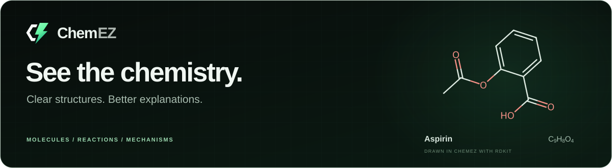
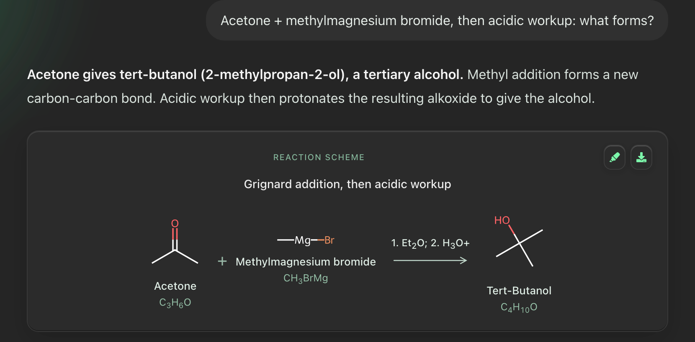

<div align="center">



<br>

<a href="https://github.com/researchbyayan/ChemEZ/releases"></a>
&nbsp;
<a href="#see-it-in-action"></a>
&nbsp;
<a href="#connect-a-model"></a>

</div>

## Download

> **ChemEZ 0.1.3 is out** as an unsigned build. It includes the bundled chemistry runtime and has passed the native packaged smoke suite. [Read the release notes](https://github.com/researchbyayan/ChemEZ/releases/tag/0.1.3).

| Platform | Installer | Requirement | Direct download |
| :--- | :--- | :--- | :--- |
| **Mac, Apple Silicon** | Native arm64 DMG | macOS 14+ | [Download DMG](https://github.com/researchbyayan/ChemEZ/releases/download/0.1.3/ChemEZ-0.1.3-mac-arm64.dmg) |
| **Mac, Intel** | Native x64 DMG | macOS 14+ | [Download DMG](https://github.com/researchbyayan/ChemEZ/releases/download/0.1.3/ChemEZ-0.1.3-mac-x64.dmg) |
| **Windows** | x64 setup EXE | Windows 10 or 11 | [Download setup](https://github.com/researchbyayan/ChemEZ/releases/download/0.1.3/ChemEZ-0.1.3-win-x64.exe) |
| **Linux** | x64 AppImage | 64-bit Linux | [Download AppImage](https://github.com/researchbyayan/ChemEZ/releases/download/0.1.3/ChemEZ-0.1.3-linux-x86_64.AppImage) |

Every installer is under 250 MB and includes RDKit and the chemistry runtime. Packaged users do not need to install Python, Node.js, LaTeX, or a local language model. Verify downloads with the [SHA256 checksums](https://github.com/researchbyayan/ChemEZ/releases/download/0.1.3/SHA256SUMS.txt). [Follow release progress](docs/RELEASE_PROGRESS.md).

ChemEZ is unsigned, so macOS and Windows may show an initial security warning. Follow the one-time opening steps in the [release notes](https://github.com/researchbyayan/ChemEZ/releases/tag/0.1.3).

**Updates:** ChemEZ checks GitHub for a new release and offers it at most once a week. On Windows and Linux it downloads in the background and installs when you restart. On Mac it downloads the new DMG and opens it for you to drag into Applications (installing in place needs an Apple-signed app). If you have the 0.1.2 beta, install 0.1.3 by hand once; it can't update itself.

## See it in action

<div align="center">
  <a href="docs/images/chemistry-chat-demo.png"></a>
  <br>
  <sub>The question, explanation, and drawn reaction in one answer. Click the image for full resolution.</sub>
</div>

<details>
<summary>Read the demo prompt and answer</summary>

**Prompt**

> Acetone + methylmagnesium bromide, then acidic workup: what forms?

**Answer**

Acetone gives **tert-butanol (2-methylpropan-2-ol), a tertiary alcohol**. Methyl addition forms a new carbon-carbon bond. Acidic workup then protonates the resulting alkoxide to give the alcohol.

The reaction drawing shows acetone and methylmagnesium bromide forming tert-butanol after the two stages: ether, then acidic workup.

<sub>This reproducible demo uses a fixed response rendered through ChemEZ's backend and RDKit.</sub>

</details>

| Ask for... | ChemEZ shows... |
| :--- | :--- |
| **One molecule** | One validated 2D drawing, its name and formula, with a 3D view when available. |
| **A reaction** | Structures arranged as a scheme with reagents, conditions, and products. |
| **A mechanism** | Ordered intermediates, supported bond changes, lone pairs, and curved arrows. |
| **An image explanation** | An attached, pasted, or dropped image interpreted by a capable model or a separate image reader. |

Choose **Quick answer**, **Explain**, or **Mechanism** for the amount of detail you need. Chemistry level lives in Settings. Equations, Markdown, syntax highlighting, fonts, and chemical notation are bundled locally.

### What makes the drawings useful

- **Answer-first layout.** Molecules and schemes appear with the explanation, with a compact structure menu on hover.
- **Chemistry checks.** RDKit validates supported structures, molecular formulas, charge, and stereochemistry before display. Supported electron-flow transitions receive additional checks.
- **Room to inspect.** Explore a structure in 3D, read its IUPAC name and formula, or save a PNG.
- **A real workspace.** Restore chats, search, keep a structure library, copy answers, and delete your data.

## Connect a model

Open **Settings → Model & API**, then sign in to OpenRouter or connect your own API key. ChemEZ supports Google Gemini, OpenAI, Anthropic, NVIDIA, and OpenAI-compatible endpoints. Model availability, image support, pricing, and quotas depend on the provider.

For image questions, you can configure a separate **Image reader**. It observes the image and passes that observation to your chat model. You do not need a local LLM.

```text
Draw butan-1-ol and identify the functional group.

Show benzene's resonance contributors and the electron movement.

Explain the SN2 mechanism of hydroxide and bromomethane.
```

Type `/` while writing a question, then **click** a command in the menu to activate it. Commands include comparison, synthesis, step-by-step work, nomenclature, lab questions, calculations, practice, and spectra.

## Your data

Chats, diagrams, attached images, and preferences stay on your device. Your selected AI provider receives the question and relevant context. Images go to the configured chat model or image reader.

API credentials are stored separately in a private local file, or kept only for the session when session-only mode is enabled. Local credential storage is **not an encrypted vault**. Read [data handling](docs/PRIVACY.md) and [backup and recovery](docs/RECOVERY.md).

> A valid molecular drawing does not prove a proposed reaction or mechanism is experimentally correct. Check important chemistry and laboratory decisions against reliable sources.

## Build from source

Use **Node.js 24** and **Python 3.11** for the release toolchain on your target operating system and architecture.

```sh
git clone https://github.com/researchbyayan/ChemEZ.git
cd ChemEZ
npm ci
npm run setup
npm run dev
```

To package locally on that same operating system and architecture:

```sh
npm run package
```

Local packages can be unsigned. The public release requires signed installers, macOS notarization, native packaged tests, and clean-machine checks. See the [development guide](docs/DEVELOPMENT.md), [release status](docs/RELEASE_PROGRESS.md), and [signing prerequisites](docs/RELEASE_SIGNING.md).

## Credits and license

ChemEZ uses Electron, React, FastAPI, RDKit, 3Dmol.js, KaTeX, Vitrio, XSMILES, and other open-source work. Bundled software, incorporated datasets, and research references are identified separately in **Settings → About → Credits & licenses**, the [attribution registry](release-config/attributions.json), and [third-party notices](THIRD_PARTY_NOTICES.md).

ChemEZ's original code is [MIT-licensed](LICENSE). Third-party components and datasets keep their own licenses.

<div align="center">

Built by [Mohammed Ayan Mahmood](https://github.com/researchbyayan) &nbsp;·&nbsp; [Report an issue](https://github.com/researchbyayan/ChemEZ/issues)

</div>
