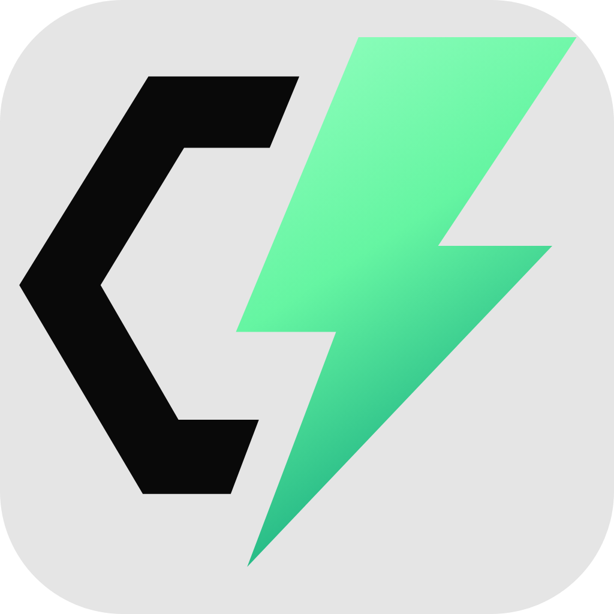
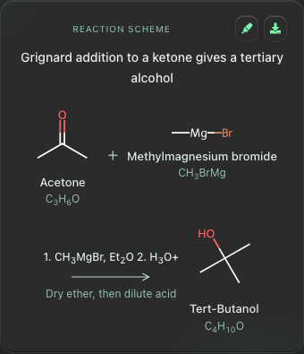

<div align="center">



# ChemEZ

### Chemistry you can actually see.

Ask a question. See the structure. Follow the electrons.

**[Downloads & releases](https://github.com/researchbyayan/ChemEZ/releases)** · **[Get started](#get-started)** · **[Build from source](#build-from-source)** · **[MIT license](LICENSE)**

</div>

## Download

| Your computer | Installer | Availability |
| :--- | :--- | :--- |
| **Mac · Apple Silicon** — M-series | Native arm64 `.dmg` · macOS 14+ | Coming soon |
| **Mac · Intel** | x64 `.dmg` · macOS 14+ | Coming soon |
| **Windows** | x64 setup `.exe` · Windows 10 / 11 | Coming soon |

**No public installers have been published yet.** [Open the releases page](https://github.com/researchbyayan/ChemEZ/releases) for downloads when they become available. Platform-specific direct links will go here once the files are published and verified.

Release goal: a complete download **under 250 MB**, with the chemistry runtime included. No separate Python, Node.js, LaTeX installation, or local language model is needed to use a packaged app.

---

## A chemistry workspace, not just a wall of text

ChemEZ is a desktop chat app for learning and exploring chemistry. Molecular drawings, reaction schemes, equations, and explanations live together in the answer—so you can follow the chemistry without translating everything in your head.

Bring your own AI service. ChemEZ handles the local drawing, formatting, and structural checks.

| Explore | What you get |
| :--- | :--- |
| **Molecules** | Readable structures, molecular formulas, names, and functional groups. |
| **Reactions** | Drawn reactants and products, reagents, conditions, and responsive layouts. |
| **Mechanisms & resonance** | Ordered panels, lone pairs, electron-flow arrows, and bond-change details where supported. |
| **3D structures** | Rotatable molecular models, alongside optional 2D detail views. |
| **Images** | Attach, paste, or drop a chemistry image using a capable model or a separate image reader. |
| **Your workspace** | Saved chats, a structure library, search, PNG exports, and answer copying. |

<div align="center">

<br>
<sub>A reaction scheme rendered in ChemEZ.</sub>
</div>

### As short—or as detailed—as you need

Choose **Quick answer**, **Explain**, or **Mechanism**. Set your chemistry level in Settings: **High school**, **University**, or **Graduate / professional**.

The interface keeps the focus on the answer: dark glass, mint accents, locally bundled math and fonts, and structure details when you need them.

## Get started

1. Open **Settings → Model & API**.
2. Sign in with **OpenRouter**, or connect a supported provider using your API key.
3. Choose an available model, connect, and ask your first question.

**Supported connections:** OpenRouter, Google Gemini, OpenAI, Anthropic, NVIDIA, and custom OpenAI-compatible endpoints. Availability, image support, pricing, and quotas depend on the service and model you choose. A consumer chat subscription does not necessarily include API usage.

Want a separate model for images? Configure the optional **Image reader**. Text questions use the chat model; image observations can be passed from the image reader to that model.

### Try asking

```text
Draw butan-1-ol and explain its functional groups.

Show the resonance contributors of benzene and explain the electron movement.

Show the SN2 mechanism of hydroxide reacting with bromomethane.
```

### A few useful shortcuts for your questions

Type `/` anywhere in your message to open the menu, then **click a command** to activate it. Typing or pasting a command does not select it. The examples below are the question text to enter after selection.

| Command | Try it |
| :--- | :--- |
| `/versus` | `chlorobenzene vs bromobenzene` |
| `/stepbystep` | `calculate the moles in 10 g of NaOH` |
| `/synthesis` | `benzene to benzoic acid` |
| `/practice` | `electrophilic aromatic substitution` |
| `/nomenclature` | `2-methylpropane` |
| `/lab` | `esterification of ethanol and ethanoic acid` |
| `/calc` | `molarity of 2 g NaOH in 250 mL` |
| `/spectra` | `acetone` |

## What stays local—and what goes to your model

Chats, attached images, diagrams, and preferences are stored on your device. Your selected AI service receives the question and relevant conversation context. Images go to the configured model or image reader.

API keys are stored separately from chat history in a private local credentials file, or kept only for the session when session-only mode is enabled. Local storage is **not an encrypted vault**. See [data handling](docs/PRIVACY.md) and [backup & recovery](docs/RECOVERY.md).

ChemEZ does not bundle a language model. RDKit and the chemistry runtime run locally; AI answers come from the service you connect.

## Chemistry needs judgment

A valid drawing is not proof of a correct reaction. ChemEZ checks structures and supported electron-flow transitions, but it cannot establish experimental correctness or guarantee an AI-proposed pathway.

Ambiguous formulas may need clarification. Unsupported diagrams show limitations. Predicted spectra are estimates, even when informed by measured-reference data; they are not measurements of your sample. Verify important chemistry and laboratory decisions with reliable sources.

## Build from source

Use **Node.js 24** and **Python 3.11** for the release toolchain, matching your computer’s architecture.

```sh
git clone https://github.com/researchbyayan/ChemEZ.git
cd ChemEZ
npm ci
npm run setup
npm run dev
```

To build a local installer on its target operating system and architecture:

```sh
npm run package
```

Local builds may be unsigned. Public installers require signing, macOS notarization, and the release checks. Apple Silicon and Windows support must be verified on their native targets; an Intel Mac build does not verify either one.

See the [development guide](docs/DEVELOPMENT.md) for architecture, checks, and configuration. [Release progress](docs/RELEASE_PROGRESS.md) records the current verification work.

## Built with open-source chemistry

ChemEZ combines **RDKit**, **Electron**, **React**, **FastAPI**, **3Dmol.js**, **KaTeX**, **Vitrio**, **XSMILES**, and other open-source work. Compound and spectral-reference data have their own provenance and terms.

Project credits distinguish **bundled software**, **incorporated data**, and **research references**. A listed research project is not necessarily an integrated engine. Explore **Settings → About → Credits & licenses**, the [attribution registry](release-config/attributions.json), and [third-party notices](THIRD_PARTY_NOTICES.md).

**ChemEZ’s original code is [MIT-licensed](LICENSE).** Third-party components and datasets retain their respective licenses.

---

Built by **[Mohammed Ayan Mahmood](https://github.com/researchbyayan)** · [Report an issue](https://github.com/researchbyayan/ChemEZ/issues)
